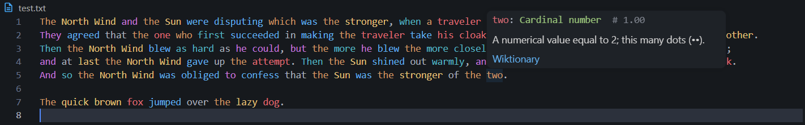

# Natural Syntax LSP

A language server that colors prose. Each word is highlighted by its part of speech, its meaning in context, or its syntactic relation, using ONNX models that run locally. Hover a word for its tag and a Wiktionary definition.

Works in VS Code and Neovim. Supports English, Spanish, French, German, Italian, Portuguese, Russian, Arabic, Japanese and Chinese, and one document can mix them.



## Modes

| Mode | Colors words by | Model |
| ---- | --------------- | ----- |
| `pos` (default) | Part of speech, using your theme's colors | BERT, XLM-R or RoBERTa tagger |
| `semantic` | Meaning in context; words used alike get similar colors | Multilingual MiniLM (50+ languages) |
| `dependency` | Universal Dependencies relation (`nsubj`, `obj`, `amod`, ...) | [diaparser](https://github.com/Unipisa/diaparser) parser |

## Quick start

1. Export a model (no package ships them, they are 100-750 MB each):

   ```bash
   scripts/setup.sh                 # English POS model
   scripts/setup.sh --list          # every available model
   ```

2. Install the editor client:
   - **VS Code**: install the `.vsix` for your platform from the [latest release](../../releases/latest) with `code --install-extension natural-syntax-ls-*.vsix`.
   - **Neovim 0.11+**: put the release binary on `PATH`, then add the plugin: `{ "WilliamMorales1/Natural-Syntax-LSP", main = "natural_syntax_ls", opts = {} }` for lazy.nvim. See [docs/neovim.md](docs/neovim.md).

3. Open [docs/examples/test.txt](docs/examples/test.txt).

Full instructions: [docs/install.md](docs/install.md).

## Documentation

See [docs/](docs/README.md) for the full index.

- [Installation](docs/install.md)
- [Features](docs/features.md)
- [Settings](docs/settings.md)
- [Neovim](docs/neovim.md)
- [Models](docs/models.md)

## Credits

Chinese Traditional/Simplified lookup uses data derived from [OpenCC](https://github.com/BYVoid/OpenCC) (Apache-2.0). See [NOTICE](NOTICE).

## License

The server is under [LICENSE](LICENSE). Exported model weights keep their source licenses, some of which are non-commercial: see [docs/models.md](docs/models.md#licenses).
