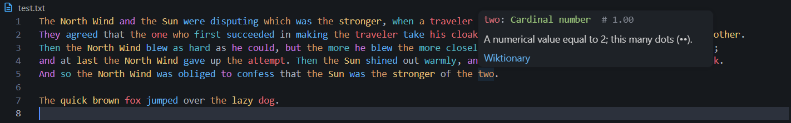

# Natural Syntax Highlighting

Colors prose by part of speech, meaning in context, or dependency relation, using a local language server running ONNX models. Hover any word for its tag and a Wiktionary definition.



- **POS** (default): part-of-speech tags, colored by your theme.
- **Semantic**: words used alike get similar colors (50+ languages).
- **Dependency**: Universal Dependencies relations.

Supports English, Spanish, French, German, Italian, Portuguese, Russian, Arabic, Japanese and Chinese. Everything runs locally. The server and ONNX Runtime are bundled (Windows x64, Linux x64, macOS arm64).

## Setup

The models are too large to bundle. Export them once from a checkout of the [repository](https://github.com/WilliamMorales1/Natural-Syntax-LSP):

```bash
scripts/setup.sh                  # English POS (~430 MB)
scripts/setup.sh --model xlmr-es  # any model from the catalog
scripts/setup.sh --list           # list the catalog
```

On Windows: `scripts/setup.ps1 -Model <name>`.

Then set `naturalSyntaxLs.mode` and a matching `naturalSyntaxLs.model`. With an English model set, installed models for other languages load automatically for documents in those languages.

## Settings

| Setting | Default | Description |
| --- | --- | --- |
| `naturalSyntaxLs.mode` | `pos` | `pos`, `semantic` or `dependency` |
| `naturalSyntaxLs.model` | `bert-base` | Model for the active mode |
| `naturalSyntaxLs.filetypes` | `["plaintext", "markdown"]` | Language IDs to activate on |
| `naturalSyntaxLs.serverPath` | `""` | Custom server binary (empty = bundled) |
| `naturalSyntaxLs.scoreThreshold` | `null` (0.333) | Minimum POS confidence to highlight |
| `naturalSyntaxLs.tokenMapUpdate` | `{}` | Override POS to token type mappings |
| `naturalSyntaxLs.wiktionaryDefinitions` | `true` | Wiktionary definitions in hover |
| `naturalSyntaxLs.wiktionaryLanguage` | `"detect,en"` | Definition language: `detect`, a code, `model`, `auto`, or a list |
| `naturalSyntaxLs.langDir` | `""` | Extra directory of language `*.lua` scripts |
| `naturalSyntaxLs.semanticLightness` | `0.75` | OKLCH lightness of semantic colors |
| `naturalSyntaxLs.semanticChroma` | `0.14` | OKLCH chroma of semantic colors |

## Documentation

[Full docs](https://github.com/WilliamMorales1/Natural-Syntax-LSP/tree/master/docs): models, tag tables, Neovim setup.
